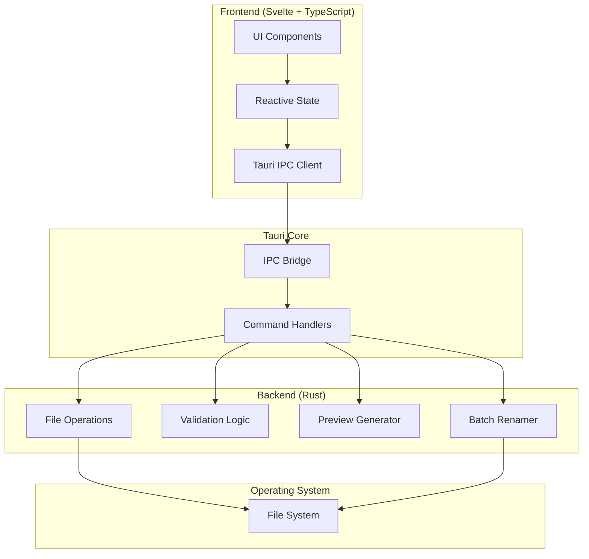

# Design Document: Batch File Renamer

## Overview

The Batch File Renamer is a cross-platform desktop application built with Tauri 2.0, providing a native, performant solution for batch file renaming operations. The application combines a Rust backend for file system operations with a Svelte + TypeScript frontend for the user interface.

### Technology Stack

- **Framework**: Tauri 2.0 (Rust backend + Web frontend)
- **Frontend**: Svelte + TypeScript + Vite
- **UI Library**: shadcn-svelte (Radix UI primitives + Tailwind CSS)
- **Backend**: Rust with tokio for async operations
- **Build System**: GitHub Actions for CI/CD
- **Package Managers**: npm (frontend), cargo (backend)

### Design Rationale

**Why Tauri over Electron:**
- Smaller bundle size (~3-5 MB vs 100+ MB for Electron)
- Lower memory footprint (uses system webview instead of bundling Chromium)
- Native performance for file operations through Rust
- Built-in security model with explicit IPC permissions
- Better suited for file-intensive operations

**Why Svelte + shadcn-svelte:**
- Reactive, component-based architecture with minimal boilerplate
- Compiler-based approach results in smaller bundle sizes and better runtime performance
- shadcn-svelte provides accessible, customizable components built on Radix UI primitives
- TypeScript ensures type safety across the frontend
- Vite provides fast development experience with excellent Svelte support
- Svelte's reactivity model simplifies state management for file operations and previews

**Why Rust backend:**
- Excellent cross-platform file system support
- Memory safety prevents common file operation bugs
- Strong error handling with Result types
- Native long path support on Windows via std::fs

## Architecture

### High-Level Architecture



### Component Interaction Flow

1. **File Selection**: User selects files via native file picker (Tauri dialog API)
2. **Configuration**: User configures prefix, starting number, additional text in Svelte UI
3. **Preview Generation**: Frontend calls Rust backend via IPC to generate preview
4. **Validation**: Backend validates configuration and file paths
5. **Execution**: User confirms, backend performs batch rename operation
6. **Feedback**: Backend streams progress/results back to frontend via events

### Security Model

Tauri's security model requires explicit capability declarations:
- File system read/write access limited to user-selected directories
- No remote content loading
- IPC commands explicitly allowlisted
- CSP headers prevent XSS attacks

## Components and Interfaces

### Frontend Components

#### 1. App Component
Root component managing application state and routing.

```svelte
<script lang="ts">
  import { writable } from 'svelte/store';
  
  let selectedFiles = writable<FileInfo[]>([]);
  let config = writable<RenameConfig>({
    prefix: 'BB',
    startingNumber: 1,
    additionalText: undefined,
    operations: []
  });
  let previewResults = writable<PreviewResult[]>([]);
  let operationStatus = writable<OperationStatus>({
    state: 'idle',
    progress: 0,
    total: 0,
    results: []
  });
</script>
```

#### 2. FileSelector Component
Handles file selection using Tauri's dialog API.

```svelte
<script lang="ts">
  import { open } from '@tauri-apps/plugin-dialog';
  import { createEventDispatcher } from 'svelte';
  
  const dispatch = createEventDispatcher<{ filesSelected: FileInfo[] }>();
  
  interface FileInfo {
    path: string;
    name: string;
    extension: string;
    size: number;
  }
  
  async function selectFiles() {
    const selected = await open({
      multiple: true,
      directory: false
    });
    
    if (selected) {
      const files = Array.isArray(selected) ? selected : [selected];
      // Process files and dispatch event
      dispatch('filesSelected', processedFiles);
    }
  }
</script>

<button on:click={selectFiles}>Select Files</button>
```

#### 3. ConfigPanel Component
Provides inputs for rename configuration.

```svelte
<script lang="ts">
  import { createEventDispatcher } from 'svelte';
  
  interface RenameConfig {
    prefix: string;
    startingNumber: number;
    additionalText?: string;
    operations: RenameOperation[];
  }
  
  type RenameOperation = 
    | { type: 'find-replace'; find: string; replace: string }
    | { type: 'add-text'; text: string; position: 'before' | 'after' }
    | { type: 'format'; format: FormatType; position: 'before' | 'after' };
  
  type FormatType =
    | { type: 'sequential'; start: number; increment: number }
    | { type: 'date'; format: string };
  
  export let config: RenameConfig;
  
  const dispatch = createEventDispatcher<{ configChange: RenameConfig }>();
  
  function updateConfig() {
    dispatch('configChange', config);
  }
</script>

<div class="config-panel">
  <input bind:value={config.prefix} on:input={updateConfig} placeholder="Prefix" />
  <input type="number" bind:value={config.startingNumber} on:input={updateConfig} min="1" max="9999" />
  <input bind:value={config.additionalText} on:input={updateConfig} placeholder="Additional text (optional)" />
</div>
```

#### 4. PreviewTable Component
Displays before/after preview of rename operation.

```svelte
<script lang="ts">
  interface PreviewResult {
    originalPath: string;
    originalName: string;
    newName: string;
    newPath: string;
    status: 'valid' | 'warning' | 'error';
    message?: string;
  }
  
  export let files: FileInfo[];
  export let previewResults: PreviewResult[];
</script>

<table class="preview-table">
  <thead>
    <tr>
      <th>Original Name</th>
      <th>New Name</th>
      <th>Status</th>
    </tr>
  </thead>
  <tbody>
    {#each previewResults as result}
      <tr class:error={result.status === 'error'} class:warning={result.status === 'warning'}>
        <td>{result.originalName}</td>
        <td>{result.newName}</td>
        <td>{result.status}</td>
      </tr>
    {/each}
  </tbody>
</table>
```

#### 5. ExecutionPanel Component
Handles batch operation execution and displays results.

```svelte
<script lang="ts">
  import { createEventDispatcher } from 'svelte';
  
  interface OperationStatus {
    state: 'idle' | 'running' | 'completed' | 'error';
    progress: number;
    total: number;
    results: RenameResult[];
  }
  
  interface RenameResult {
    originalPath: string;
    newPath: string;
    success: boolean;
    error?: string;
  }
  
  export let status: OperationStatus;
  
  const dispatch = createEventDispatcher<{ execute: void }>();
  
  async function handleExecute() {
    dispatch('execute');
  }
</script>

<div class="execution-panel">
  <button on:click={handleExecute} disabled={status.state === 'running'}>
    {status.state === 'running' ? 'Renaming...' : 'Execute Rename'}
  </button>
  
  {#if status.state === 'running'}
    <progress value={status.progress} max={status.total}></progress>
    <span>{status.progress} / {status.total}</span>
  {/if}
  
  {#if status.state === 'completed'}
    <div class="results">
      {#each status.results as result}
        <div class:success={result.success} class:error={!result.success}>
          {result.originalPath} → {result.newPath}
          {#if result.error}
            <span class="error-message">{result.error}</span>
          {/if}
        </div>
      {/each}
    </div>
  {/if}
</div>
```

### Backend Components (Rust)

#### 1. File Operations Module (`file_ops.rs`)

```rust
pub struct FileMetadata {
    pub path: PathBuf,
    pub name: String,
    pub extension: Option<String>,
    pub size: u64,
}

pub fn get_file_info(path: &Path) -> Result<FileMetadata, FileError>;
pub fn validate_path_length(path: &Path, os: OperatingSystem) -> Result<(), PathError>;
pub fn rename_file(old_path: &Path, new_path: &Path) -> Result<(), RenameError>;
```

#### 2. Validation Module (`validator.rs`)

```rust
pub struct ValidationResult {
    pub valid: bool,
    pub errors: Vec<ValidationError>,
    pub warnings: Vec<ValidationWarning>,
}

pub fn validate_prefix(prefix: &str, os: OperatingSystem) -> Result<(), ValidationError>;
pub fn validate_starting_number(num: u32) -> Result<(), ValidationError>;
pub fn validate_target_path(path: &Path, os: OperatingSystem) -> ValidationResult;
pub fn check_file_exists(path: &Path) -> bool;
pub fn check_file_permissions(path: &Path) -> Result<(), PermissionError>;
```

#### 3. Preview Generator Module (`preview.rs`)

```rust
pub struct PreviewGenerator {
    config: RenameConfig,
    os: OperatingSystem,
}

impl PreviewGenerator {
    pub fn new(config: RenameConfig, os: OperatingSystem) -> Self;
    pub fn generate_preview(&self, files: &[FileMetadata]) -> Vec<PreviewResult>;
    fn apply_operations(&self, filename: &str) -> String;
    fn construct_target_name(&self, original: &str, seq_num: u32) -> String;
}
```

#### 4. Batch Renamer Module (`renamer.rs`)

```rust
pub struct BatchRenamer {
    config: RenameConfig,
    os: OperatingSystem,
}

impl BatchRenamer {
    pub fn new(config: RenameConfig, os: OperatingSystem) -> Self;
    pub async fn execute(&self, files: &[FileMetadata]) -> Vec<RenameResult>;
    async fn rename_single(&self, file: &FileMetadata, seq_num: u32) -> RenameResult;
}
```

#### 5. Tauri Commands Module (`commands.rs`)

```rust
#[tauri::command]
async fn get_file_info(paths: Vec<String>) -> Result<Vec<FileMetadata>, String>;

#[tauri::command]
async fn generate_preview(
    files: Vec<FileMetadata>,
    config: RenameConfig
) -> Result<Vec<PreviewResult>, String>;

#[tauri::command]
async fn validate_config(config: RenameConfig) -> Result<ValidationResult, String>;

#[tauri::command]
async fn execute_batch_rename(
    files: Vec<FileMetadata>,
    config: RenameConfig,
    window: tauri::Window
) -> Result<Vec<RenameResult>, String>;
```

### IPC Interface

Communication between frontend and backend uses Tauri's IPC system:

```typescript
// Frontend calls to backend (in Svelte components)
import { invoke } from '@tauri-apps/api/core';
import { listen } from '@tauri-apps/api/event';

// Example usage in a Svelte component
async function loadFileInfo(paths: string[]) {
  const fileInfo = await invoke<FileMetadata[]>('get_file_info', { paths });
  return fileInfo;
}

async function generatePreview(files: FileMetadata[], config: RenameConfig) {
  const preview = await invoke<PreviewResult[]>('generate_preview', { files, config });
  return preview;
}

async function validateConfig(config: RenameConfig) {
  const validation = await invoke<ValidationResult>('validate_config', { config });
  return validation;
}

async function executeBatchRename(files: FileMetadata[], config: RenameConfig) {
  const results = await invoke<RenameResult[]>('execute_batch_rename', { files, config });
  return results;
}

// Backend events to frontend (in Svelte onMount or component script)
import { onMount } from 'svelte';

onMount(() => {
  const unlisten = listen<ProgressEvent>('rename-progress', (event) => {
    // Update reactive state
    operationStatus.update(status => ({
      ...status,
      progress: event.payload.progress
    }));
  });
  
  return () => {
    unlisten.then(fn => fn());
  };
});
```

## Data Models

### Core Data Structures

```typescript
// Frontend TypeScript models
interface RenameConfig {
  prefix: string;              // Default: "BB"
  startingNumber: number;      // Range: 1-9999, Default: 1
  additionalText?: string;     // Optional
  operations: RenameOperation[]; // For Requirement 12
}

interface FileInfo {
  path: string;
  name: string;
  extension: string;
  size: number;
}

interface PreviewResult {
  originalPath: string;
  originalName: string;
  newName: string;
  newPath: string;
  status: 'valid' | 'warning' | 'error';
  message?: string;
}

interface RenameResult {
  originalPath: string;
  newPath: string;
  success: boolean;
  error?: string;
}
```

```rust
// Backend Rust models
#[derive(Debug, Clone, Serialize, Deserialize)]
pub struct RenameConfig {
    pub prefix: String,
    pub starting_number: u32,
    pub additional_text: Option<String>,
    pub operations: Vec<RenameOperation>,
}

#[derive(Debug, Clone, Serialize, Deserialize)]
pub enum RenameOperation {
    FindReplace { find: String, replace: String },
    AddText { text: String, position: TextPosition },
    Format { format: FormatType, position: TextPosition },
}

#[derive(Debug, Clone, Serialize, Deserialize)]
pub enum FormatType {
    Sequential { start: u32, increment: u32 },
    Date { format: String },
}

#[derive(Debug, Clone, Serialize, Deserialize)]
pub enum TextPosition {
    Before,
    After,
}

#[derive(Debug, Clone, Serialize, Deserialize)]
pub struct FileMetadata {
    pub path: String,
    pub name: String,
    pub extension: Option<String>,
    pub size: u64,
}

#[derive(Debug, Clone, Serialize, Deserialize)]
pub struct PreviewResult {
    pub original_path: String,
    pub original_name: String,
    pub new_name: String,
    pub new_path: String,
    pub status: PreviewStatus,
    pub message: Option<String>,
}

#[derive(Debug, Clone, Serialize, Deserialize)]
pub enum PreviewStatus {
    Valid,
    Warning,
    Error,
}

#[derive(Debug, Clone, Serialize, Deserialize)]
pub struct RenameResult {
    pub original_path: String,
    pub new_path: String,
    pub success: bool,
    pub error: Option<String>,
}
```

### Naming Convention Algorithm

The target filename is constructed as follows:

```
[prefix]_[NNNN]_[additional_text]_[original_filename]
```

Where:
- `prefix`: User-defined or default "BB"
- `NNNN`: 4-digit zero-padded sequential number (0001-9999)
- `additional_text`: Optional user-defined text (omitted if not provided)
- `original_filename`: Complete original filename including extension

Examples:
- `BB_0001_DailyRush_video.mp4` (with additional text)
- `KCOC4_0042_scene5_audio.wav` (custom prefix with additional text)
- `ProjectX_0100_document.pdf` (custom prefix, no additional text)

### Path Length Validation

```rust
const MAX_PATH_WINDOWS: usize = 32767;  // With long path support
const MAX_PATH_MACOS: usize = 1024;
const WARN_PATH_WINDOWS: usize = 260;   // Legacy limit

fn validate_path_length(path: &Path, os: OperatingSystem) -> ValidationResult {
    let path_str = path.to_string_lossy();
    let len = path_str.len();
    
    let (max_len, warn_len) = match os {
        OperatingSystem::Windows => (MAX_PATH_WINDOWS, Some(WARN_PATH_WINDOWS)),
        OperatingSystem::MacOS => (MAX_PATH_MACOS, None),
    };
    
    if len > max_len {
        ValidationResult::error(format!("Path exceeds maximum length of {}", max_len))
    } else if let Some(warn) = warn_len {
        if len > warn {
            ValidationResult::warning(format!("Path exceeds {} characters", warn))
        } else {
            ValidationResult::valid()
        }
    } else {
        ValidationResult::valid()
    }
}
```

## Build and Deployment Strategy

### Target Platform Requirements

**Windows:**
- Primary target: Windows 11
- Backward compatibility: Windows 10 (fully supported)
- Architecture: x64

**macOS:**
- Primary target: macOS Ventura (13.0) and later
- Architecture: Universal binary (Intel x86_64 + Apple Silicon arm64)

### Distribution Options

The application supports two distribution approaches for macOS:

**Option 1: Unsigned/Unnotarized (No Apple Developer Account Required)**
- Build process: Standard Tauri build without signing
- User experience: Right-click → "Open" required on first launch
- Cost: Free
- Best for: Internal team use, testing, personal projects

**Option 2: Signed and Notarized (Apple Developer Account Required)**
- Build process: Sign with Developer ID certificate, submit for notarization
- User experience: Double-click to open (seamless)
- Cost: $99/year Apple Developer Program membership
- Best for: Public distribution, professional releases

Both options produce fully functional applications. The only difference is the initial launch experience.

### GitHub Actions CI/CD Pipeline

The build system uses GitHub Actions to create platform-specific builds:

```yaml
# .github/workflows/build.yml
name: Build and Release

on:
  push:
    tags:
      - 'v*'
  workflow_dispatch:

jobs:
  build-windows:
    runs-on: windows-latest
    steps:
      - uses: actions/checkout@v4
      - name: Setup Node.js
        uses: actions/setup-node@v4
        with:
          node-version: '20'
      - name: Setup Rust
        uses: dtolnay/rust-toolchain@stable
      - name: Install dependencies
        run: npm ci
      - name: Build Tauri app
        run: npm run tauri build
      - name: Upload Windows artifacts
        uses: actions/upload-artifact@v4
        with:
          name: windows-installer
          path: src-tauri/target/release/bundle/msi/*.msi

  build-macos:
    runs-on: macos-13  # macOS Ventura - supports building for macOS 13.0+
    steps:
      - uses: actions/checkout@v4
      - name: Setup Node.js
        uses: actions/setup-node@v4
        with:
          node-version: '20'
      - name: Setup Rust
        uses: dtolnay/rust-toolchain@stable
        with:
          targets: aarch64-apple-darwin,x86_64-apple-darwin
      - name: Install dependencies
        run: npm ci
      # Build without signing/notarization by default
      # The app will work but users need to right-click -> Open on first launch
      # To enable signing, add APPLE_CERTIFICATE and APPLE_ID secrets to the repository
      - name: Build Tauri app (Universal)
        run: npm run tauri build -- --target universal-apple-darwin
        env:
          # Conditional signing: only sign if secrets are available
          APPLE_CERTIFICATE: ${{ secrets.APPLE_CERTIFICATE }}
          APPLE_CERTIFICATE_PASSWORD: ${{ secrets.APPLE_CERTIFICATE_PASSWORD }}
          APPLE_SIGNING_IDENTITY: ${{ secrets.APPLE_SIGNING_IDENTITY }}
          APPLE_ID: ${{ secrets.APPLE_ID }}
          APPLE_PASSWORD: ${{ secrets.APPLE_PASSWORD }}
          APPLE_TEAM_ID: ${{ secrets.APPLE_TEAM_ID }}
      - name: Upload macOS artifacts
        uses: actions/upload-artifact@v4
        with:
          name: macos-installer
          path: src-tauri/target/release/bundle/dmg/*.dmg

  create-release:
    needs: [build-windows, build-macos]
    runs-on: ubuntu-latest
    steps:
      - name: Download artifacts
        uses: actions/download-artifact@v4
      - name: Create Release
        uses: softprops/action-gh-release@v1
        with:
          files: |
            windows-installer/*.msi
            macos-installer/*.dmg
```

### Platform-Specific Packaging

**Windows:**
- Target OS: Windows 11 (also compatible with Windows 10)
- Output: MSI installer
- Code signing: Optional (requires certificate for seamless installation)
- Long path support: Enabled via app manifest

**macOS:**
- Target OS: macOS Ventura (13.0) and later
- Output: Universal DMG (Intel + Apple Silicon)
- Code signing: Optional (requires Apple Developer account)
- Notarization: Optional (requires Apple Developer account)

**Building without Apple Developer Account:**

The macOS app can be built and distributed without an Apple Developer account or notarization. However, users will need to take an extra step on first launch:

- **With notarization**: Users can double-click to open (seamless experience)
- **Without notarization**: Users must right-click the app → select "Open" → confirm in the dialog to bypass Gatekeeper

This is a one-time action per user. After the first launch, the app opens normally with double-click. The app is fully functional in both cases; notarization only affects the initial launch experience.

### Tauri Configuration

```json
// src-tauri/tauri.conf.json
{
  "build": {
    "beforeDevCommand": "npm run dev",
    "beforeBuildCommand": "npm run build",
    "devPath": "http://localhost:5173",
    "distDir": "../dist"
  },
  "package": {
    "productName": "Batch File Renamer",
    "version": "1.0.0"
  },
  "tauri": {
    "allowlist": {
      "dialog": {
        "open": true
      },
      "fs": {
        "scope": ["$DOCUMENT/*", "$DOWNLOAD/*", "$DESKTOP/*"]
      }
    },
    "bundle": {
      "active": true,
      "targets": ["msi", "dmg"],
      "identifier": "com.postproduction.batch-file-renamer",
      "icon": [
        "icons/32x32.png",
        "icons/128x128.png",
        "icons/icon.icns",
        "icons/icon.ico"
      ],
      "macOS": {
        "minimumSystemVersion": "13.0"
      },
      "windows": {
        "wix": {
          "language": "en-US"
        }
      }
    },
    "windows": [
      {
        "title": "Batch File Renamer",
        "width": 1000,
        "height": 700,
        "resizable": true,
        "fullscreen": false
      }
    ]
  }
}
```

### Development Workflow

```bash
# Install dependencies
npm install

# Run development server
npm run tauri dev

# Build for production
npm run tauri build

# Run tests
npm test                    # Frontend tests
cargo test --manifest-path src-tauri/Cargo.toml  # Backend tests
```

### Long Path Support on Windows

Enable long path support in Rust:

```rust
// src-tauri/src/main.rs
#[cfg(target_os = "windows")]
fn enable_long_paths() {
    use std::os::windows::fs::MetadataExt;
    // Rust's std::fs automatically uses \\?\ prefix for long paths
    // No additional configuration needed in Rust 1.70+
}
```

Application manifest for Windows:

```xml
<!-- src-tauri/resources/app.manifest -->
<assembly xmlns="urn:schemas-microsoft-com:asm.v1" manifestVersion="1.0">
  <application xmlns="urn:schemas-microsoft-com:asm.v3">
    <windowsSettings>
      <longPathAware xmlns="http://schemas.microsoft.com/SMI/2016/WindowsSettings">true</longPathAware>
    </windowsSettings>
  </application>
</assembly>
```


## Correctness Properties

A property is a characteristic or behavior that should hold true across all valid executions of a system—essentially, a formal statement about what the system should do. Properties serve as the bridge between human-readable specifications and machine-verifiable correctness guarantees.

### Property 1: File Selection Order Preservation

For any ordered list of files selected by the user, the sequential numbers assigned during renaming should match the selection order, with the first selected file receiving the starting number and each subsequent file receiving an incremented number.

**Validates: Requirements 1.4, 6.2**

### Property 2: Sequential Number Formatting and Incrementing

For any batch of files with a given starting number, each file should receive a sequential number that is exactly 1 greater than the previous file's number, and all sequential numbers should be formatted as 4-digit zero-padded strings (e.g., 0001, 0002, 0003).

**Validates: Requirements 2.2, 2.3**

### Property 3: Starting Number Validation

For any input starting number, the validation should accept values in the range 1-9999 (inclusive) and reject all values outside this range with an error message that prevents batch operation execution.

**Validates: Requirements 3.2, 3.3**

### Property 4: Additional Text Omission

For any file when additional text is not provided in the configuration, the generated target filename should not contain an additional text component (no extra underscore-separated segment between the sequential number and original filename).

**Validates: Requirements 3.1.4, 4.5**

### Property 5: Prefix Character Validation

For any prefix string, the validation should accept only characters that are valid for filenames on the target operating system and reject invalid characters with an error message that prevents batch operation execution.

**Validates: Requirements 3.1.5, 3.1.6**

### Property 6: Naming Convention Format

For any source file and rename configuration (prefix, sequential number, optional additional text), the generated target filename should follow the format `[prefix]_[NNNN]_[additional_text]_[original_filename]` where NNNN is the 4-digit sequential number, additional_text is included only if provided, and all components are separated by underscores.

**Validates: Requirements 4.1, 4.6**

### Property 7: Original Filename Preservation

For any source file, the complete original filename including its extension should appear as the final component in the target filename.

**Validates: Requirements 4.2**

### Property 8: Extension Case Preservation

For any file with an extension, the case of the extension (uppercase, lowercase, or mixed case) should be preserved exactly in the target filename.

**Validates: Requirements 4.3**

### Property 9: Additional Text Positioning

For any file when additional text is provided in the configuration, the additional text should appear in the target filename between the sequential number and the original filename, separated by underscores.

**Validates: Requirements 4.4**

### Property 10: Preview Generation

For any set of selected files and rename configuration, the preview should display both the original filename and the generated target filename for each file.

**Validates: Requirements 5.1**

### Property 11: Preview Reactivity

For any change to the configuration (prefix, starting number, or additional text), the preview should update to reflect the new target filenames based on the updated configuration.

**Validates: Requirements 5.2**

### Property 12: Batch Rename Completeness

For any batch of files, when the user confirms the operation, all files should be renamed to their corresponding target names as shown in the preview.

**Validates: Requirements 6.1**

### Property 13: File Location Preservation

For any file being renamed, the directory path should remain unchanged—only the filename component should be modified.

**Validates: Requirements 6.3**

### Property 14: Success Message with Count

For any successful batch operation, the system should display a success message that includes the count of successfully renamed files.

**Validates: Requirements 6.4**

### Property 15: Duplicate Target Name Handling

For any file where the target filename already exists in the same directory, the system should display an error message for that file and skip renaming it while continuing to process remaining files.

**Validates: Requirements 7.1**

### Property 16: Permission Error Handling

For any file that cannot be renamed due to insufficient permissions, the system should display an error message for that file and skip renaming it while continuing to process remaining files.

**Validates: Requirements 7.2**

### Property 17: Error Continuation

For any batch operation where one or more files encounter errors, the system should continue processing all remaining files in the batch.

**Validates: Requirements 7.3**

### Property 18: Error Summary Reporting

For any batch operation that completes with one or more errors, the system should display a summary that lists which files failed to rename and the reason for each failure.

**Validates: Requirements 7.4**

### Property 19: Cross-Platform Functional Consistency

For any rename operation with the same configuration and file inputs, the system should produce identical results (same target filenames and behavior) on both Windows and macOS platforms.

**Validates: Requirements 8.3**

### Property 20: Visual Feedback During Operations

For any batch rename operation in progress, the system should provide visual feedback (such as progress indicators or status updates) to inform the user of the operation's progress.

**Validates: Requirements 9.4**

### Property 21: File Extension Support

For any file with any file extension (including uncommon or custom extensions), the system should successfully rename the file while preserving the extension.

**Validates: Requirements 10.1**

### Property 22: Special Character Handling

For any filename containing special characters that are permitted by the operating system (such as spaces, hyphens, parentheses), the system should successfully rename the file while preserving those characters.

**Validates: Requirements 10.3**

### Property 23: Long Path Access on Windows

For any file path exceeding 260 characters on Windows, the system should successfully access and rename the file using long path support mechanisms.

**Validates: Requirements 11.2**

### Property 24: Long Path Warning

For any target file path that would exceed 260 characters on Windows, the system should display a warning message before attempting the rename operation.

**Validates: Requirements 11.3**

### Property 25: Path Length Validation

For any target file path, the system should validate that the complete path length does not exceed the operating system maximum (32,767 characters on Windows, 1,024 characters on macOS).

**Validates: Requirements 11.4**

### Property 26: Path Length Error Handling

For any target file path that would exceed the operating system maximum path length, the system should display an error message and skip renaming that file.

**Validates: Requirements 11.5**

### Property 27: Find-and-Replace Operation

For any filename and find-and-replace configuration (search text and replacement text), the system should replace all occurrences of the search text with the replacement text in the filename.

**Validates: Requirements 12.1, 12.2**

### Property 28: Add-Text Operation Positioning

For any filename and add-text configuration (text and position), the system should insert the text at the specified position: before the filename (at the start) or after the filename but before the extension.

**Validates: Requirements 12.3, 12.4**

### Property 29: Sequential Format Operation

For any batch of files with a sequential format operation configured, the system should add sequential numbers to each filename according to the configuration.

**Validates: Requirements 12.5**

### Property 30: Counter Format Operation

For any batch of files with a counter format operation configured (start value and increment), the system should add counter values to each filename that increment by the specified amount starting from the specified start value.

**Validates: Requirements 12.6**

### Property 31: Date Format Operation

For any file with a date format operation configured (date format string), the system should add a date stamp to the filename formatted according to the specified format string.

**Validates: Requirements 12.7**

### Property 32: Format Operation Positioning

For any format operation (sequential, counter, or date) with a specified position, the formatted text should appear at the specified position: before or after the original filename.

**Validates: Requirements 12.8**

### Property 33: Multiple Operations Composition

For any batch of files with multiple rename operations configured (such as find-replace followed by add-text), the system should apply all operations in sequence to produce the final target filename.

**Validates: Requirements 12.9**

### Property 34: Multi-Operation Preview

For any set of selected rename operations, the preview should display the result of applying all operations in sequence, showing the final target filename that would result from executing all operations.

**Validates: Requirements 12.10**

## Error Handling

### Error Categories

The application handles four main categories of errors:

1. **Validation Errors**: Detected before operation execution
   - Invalid starting number (outside 1-9999 range)
   - Invalid prefix characters for the target OS
   - Target path exceeds OS maximum length

2. **File System Errors**: Detected during operation execution
   - Target file already exists
   - Insufficient permissions
   - File locked by another process
   - Disk full

3. **Path Errors**: Related to file path handling
   - Path too long (with warnings at 260 chars on Windows)
   - Invalid path characters
   - Path not found

4. **Operation Errors**: Related to batch processing
   - Partial batch failure (some files succeed, others fail)
   - Complete batch failure (all files fail)

### Error Handling Strategy

```rust
// Error types
#[derive(Debug, thiserror::Error)]
pub enum RenamerError {
    #[error("Invalid starting number: {0}. Must be between 1 and 9999")]
    InvalidStartingNumber(u32),
    
    #[error("Invalid prefix: {0}. Contains characters not allowed in filenames")]
    InvalidPrefix(String),
    
    #[error("Target file already exists: {0}")]
    FileExists(String),
    
    #[error("Permission denied: {0}")]
    PermissionDenied(String),
    
    #[error("Path too long: {0} characters (max: {1})")]
    PathTooLong(usize, usize),
    
    #[error("File system error: {0}")]
    FileSystemError(#[from] std::io::Error),
}

// Result type for operations
pub type RenamerResult<T> = Result<T, RenamerError>;

// Batch operation result
pub struct BatchResult {
    pub successful: Vec<RenameResult>,
    pub failed: Vec<(FileMetadata, RenamerError)>,
}

impl BatchResult {
    pub fn success_count(&self) -> usize {
        self.successful.len()
    }
    
    pub fn failure_count(&self) -> usize {
        self.failed.len()
    }
    
    pub fn is_complete_success(&self) -> bool {
        self.failed.is_empty()
    }
}
```

### Error Recovery

The application implements graceful error recovery:

1. **Pre-validation**: Validate all inputs before starting batch operation
2. **Fail-fast for validation**: Stop immediately if configuration is invalid
3. **Continue on file errors**: Skip individual files that fail, continue with remaining files
4. **Detailed reporting**: Provide specific error messages for each failure
5. **No partial renames**: Each file rename is atomic (succeeds completely or not at all)

### User-Facing Error Messages

Error messages should be:
- **Specific**: Identify which file failed and why
- **Actionable**: Suggest how to resolve the issue when possible
- **Non-technical**: Use plain language for common errors

Examples:
- ❌ "Cannot rename 'video.mp4': A file with the name 'BB_0001_video.mp4' already exists"
- ❌ "Cannot rename 'document.pdf': Permission denied. The file may be open in another program"
- ⚠️ "Warning: Target path for 'long_filename.txt' exceeds 260 characters and may not be compatible with older Windows applications"

## Testing Strategy

### Dual Testing Approach

The testing strategy employs both unit tests and property-based tests to ensure comprehensive coverage:

- **Unit tests**: Verify specific examples, edge cases, and error conditions
- **Property-based tests**: Verify universal properties across all inputs

Both approaches are complementary and necessary. Unit tests catch concrete bugs and verify specific behaviors, while property-based tests verify general correctness across a wide range of inputs.

### Property-Based Testing Configuration

**Library Selection:**
- **Rust backend**: Use `proptest` crate for property-based testing
- **TypeScript frontend**: Use `fast-check` library for property-based testing

**Test Configuration:**
- Each property test must run a minimum of 100 iterations
- Each test must include a comment tag referencing the design property
- Tag format: `// Feature: batch-file-renamer, Property {number}: {property_text}`

**Example Property Test (Rust):**

```rust
use proptest::prelude::*;

// Feature: batch-file-renamer, Property 2: Sequential Number Formatting and Incrementing
#[test]
fn test_sequential_number_formatting() {
    proptest!(|(
        starting_num in 1u32..=9999,
        file_count in 1usize..=20
    )| {
        let files = generate_test_files(file_count);
        let config = RenameConfig {
            prefix: "TEST".to_string(),
            starting_number: starting_num,
            additional_text: None,
            operations: vec![],
        };
        
        let preview = PreviewGenerator::new(config, OperatingSystem::current())
            .generate_preview(&files);
        
        for (i, result) in preview.iter().enumerate() {
            let expected_num = starting_num + i as u32;
            let expected_formatted = format!("{:04}", expected_num);
            assert!(result.new_name.contains(&expected_formatted));
            
            // Check incrementing
            if i > 0 {
                let prev_num = starting_num + (i - 1) as u32;
                assert_eq!(expected_num, prev_num + 1);
            }
        }
    });
}
```

**Example Property Test (TypeScript with Svelte):**

```typescript
import fc from 'fast-check';
import { describe, test, expect } from 'vitest';

// Feature: batch-file-renamer, Property 6: Naming Convention Format
describe('Naming Convention Properties', () => {
  test('naming convention format property', () => {
    fc.assert(
      fc.property(
        fc.string({ minLength: 1, maxLength: 20 }).filter(isValidPrefix),
        fc.integer({ min: 1, max: 9999 }),
        fc.option(fc.string({ minLength: 1, maxLength: 20 })),
        fc.string({ minLength: 1, maxLength: 50 }),
        (prefix, seqNum, additionalText, originalName) => {
          const result = generateTargetName({
            prefix,
            sequentialNumber: seqNum,
            additionalText,
            originalName,
          });
          
          // Verify format
          const parts = result.split('_');
          expect(parts[0]).toBe(prefix);
          expect(parts[1]).toBe(seqNum.toString().padStart(4, '0'));
          
          if (additionalText) {
            expect(parts[2]).toBe(additionalText);
            expect(parts[3]).toBe(originalName);
          } else {
            expect(parts[2]).toBe(originalName);
          }
        }
      ),
      { numRuns: 100 }
    );
  });
});
```

### Unit Testing Strategy

Unit tests focus on:

1. **Specific Examples**:
   - Default values (starting number 0001, prefix "BB")
   - Specific rename scenarios from requirements
   - Platform-specific behaviors

2. **Edge Cases**:
   - Maximum sequential number (9999)
   - Files without extensions
   - Maximum path lengths
   - Empty file lists
   - Single file operations

3. **Error Conditions**:
   - Invalid starting numbers (0, 10000, negative)
   - Invalid prefix characters (OS-specific)
   - Duplicate target filenames
   - Permission errors
   - Path length violations

4. **Integration Points**:
   - IPC communication between frontend and backend
   - File system operations on actual test files
   - UI component interactions

**Example Unit Tests:**

```rust
#[cfg(test)]
mod tests {
    use super::*;

    #[test]
    fn test_default_prefix() {
        let config = RenameConfig::default();
        assert_eq!(config.prefix, "BB");
    }

    #[test]
    fn test_default_starting_number() {
        let config = RenameConfig::default();
        assert_eq!(config.starting_number, 1);
    }

    #[test]
    fn test_max_sequential_number() {
        let result = validate_starting_number(9999);
        assert!(result.is_ok());
    }

    #[test]
    fn test_invalid_starting_number_too_high() {
        let result = validate_starting_number(10000);
        assert!(result.is_err());
    }

    #[test]
    fn test_file_without_extension() {
        let file = FileMetadata {
            path: "/test/README".into(),
            name: "README".into(),
            extension: None,
            size: 1024,
        };
        
        let config = RenameConfig {
            prefix: "DOC".into(),
            starting_number: 1,
            additional_text: None,
            operations: vec![],
        };
        
        let generator = PreviewGenerator::new(config, OperatingSystem::Unix);
        let preview = generator.generate_preview(&[file]);
        
        assert_eq!(preview[0].new_name, "DOC_0001_README");
    }

    #[test]
    #[cfg(target_os = "windows")]
    fn test_long_path_support() {
        let long_path = "C:\\".to_string() + &"a\\".repeat(200) + "file.txt";
        let result = validate_path_length(Path::new(&long_path), OperatingSystem::Windows);
        assert!(result.is_ok());
    }
}
```

### Test Coverage Goals

- **Backend (Rust)**: Minimum 80% code coverage
- **Frontend (TypeScript)**: Minimum 70% code coverage
- **Property tests**: All 34 correctness properties must have corresponding tests
- **Integration tests**: Cover complete workflows (select → configure → preview → execute)

### Continuous Integration

Tests run automatically on:
- Every pull request
- Every commit to main branch
- Before creating release builds

CI pipeline includes:
- Unit tests (Rust + TypeScript)
- Property-based tests (100+ iterations each)
- Integration tests
- Platform-specific tests (Windows and macOS runners)
- Code coverage reporting

